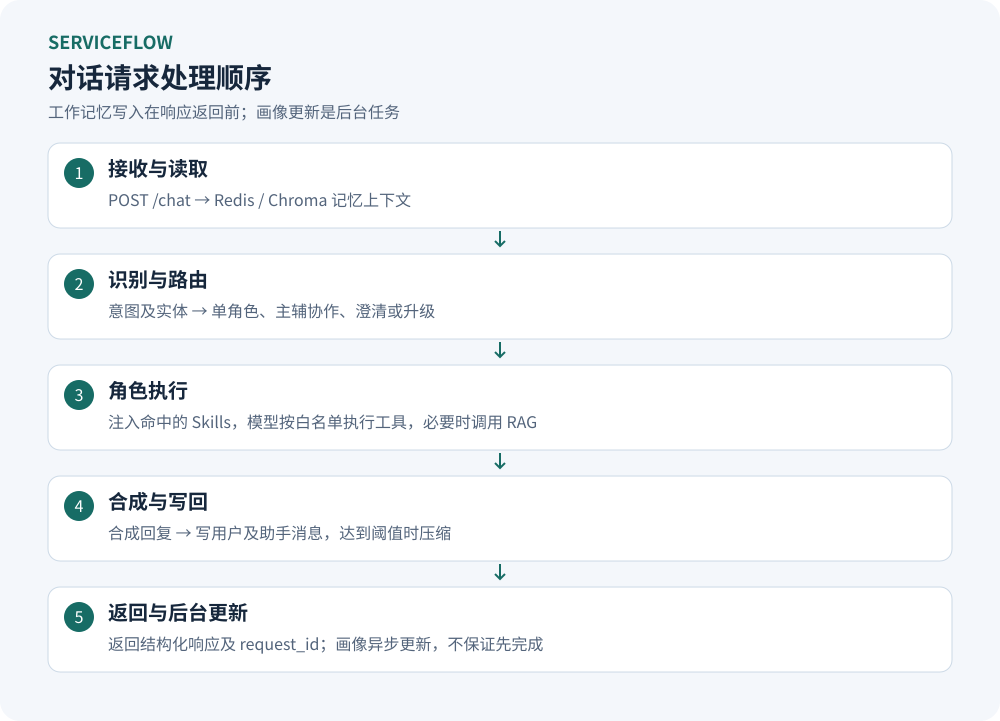
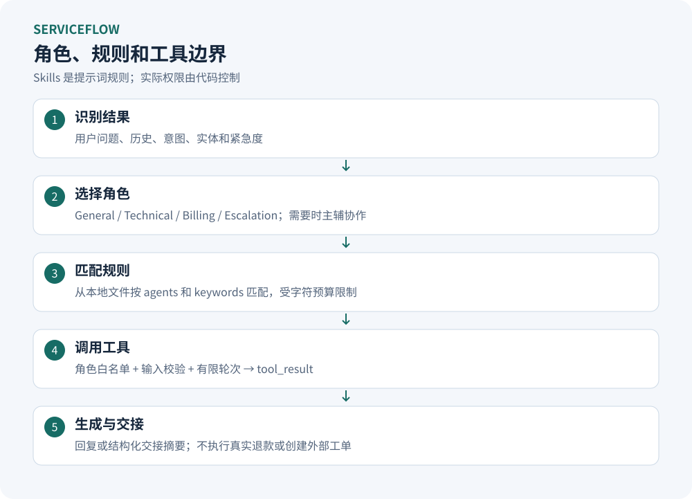
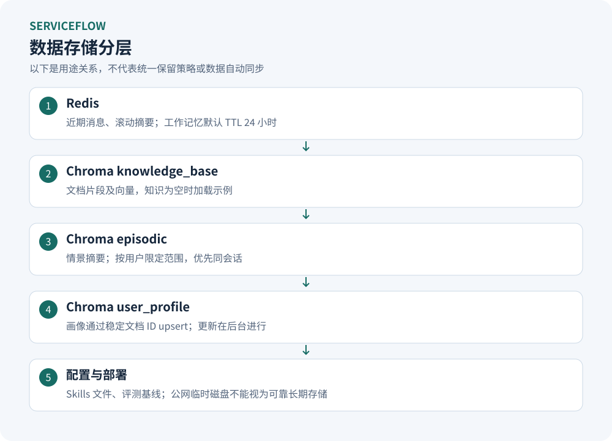
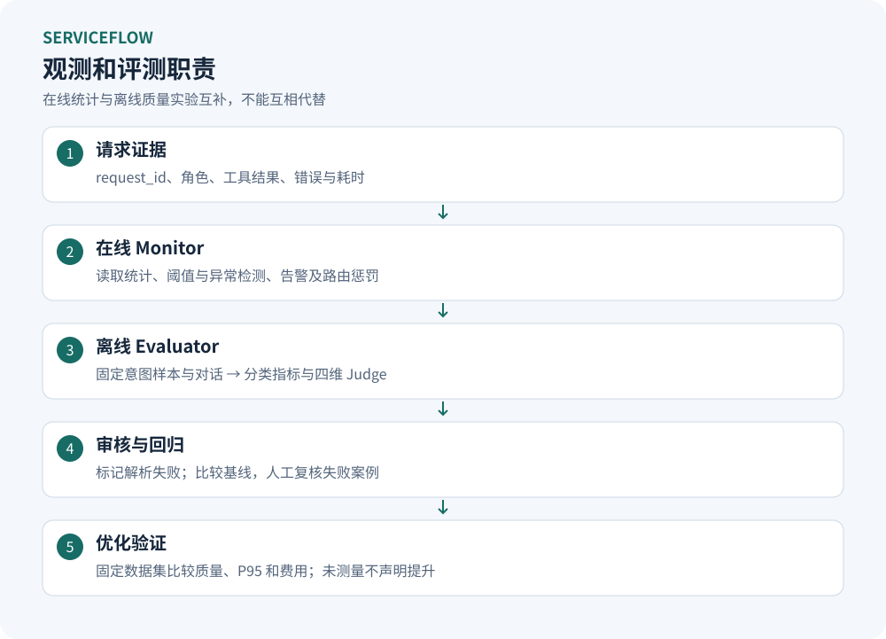
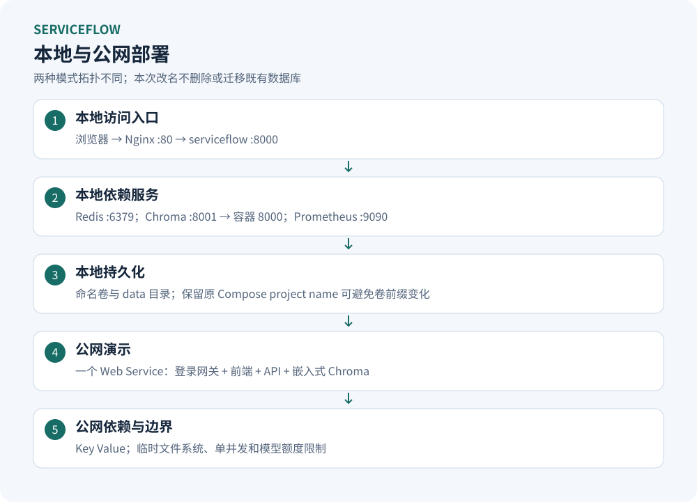

# ServiceFlow 架构与部署

## 逻辑分层

```text
浏览器工作台（HTML / CSS / JavaScript）
  ├─ 本地：Nginx → FastAPI
  └─ 公网：登录网关 → FastAPI
                       ├─ IntentRecognizer → 主辅角色路由
                       ├─ Agent → Skills / 白名单工具 / Composer
                       ├─ 工具管理 → 改写 / 召回 / 重排 / 缓存 / 熔断
                       ├─ Redis → 工作记忆与摘要
                       ├─ Chroma → 知识 / 情景 / 画像
                       └─ 请求轨迹 / Monitor / 离线 Evaluator
```

## 主链路



入口先读取记忆，再分析意图，执行角色与工具，生成最终回复后写回。画像更新在后台执行。LLM 生成、Redis 写入和 Chroma 写入并非同一事务。

## 角色与规则



技能文本补充行为准则，工具白名单控制实际可执行范围；两者不能互相替代。复杂问题可以并行，但不等于所有请求都会启用多 Agent。

## 数据分层



Chroma 的三个 collection 保持名称稳定。连接独立服务失败时切到本地存储，两处数据不会自动合并。生产需要显式存储模式、迁移和备份策略。

## 观测和评测



图示表达模块关系，不代表默认配置已启用所有指标或真实达成性能提升。指标注册、数据集和实验报告仍应分别检查。

## 部署拓扑



本地由 `serviceflow`、Redis、Chroma、Prometheus、Nginx 五个服务组成，Compose 服务名用于容器内 DNS。

公网演示不是这个五容器拓扑：它使用一个 Web Service、一个 Key Value，静态页面由网关提供，Chroma 嵌入 Web 进程，数据目录为临时文件系统。两种模式的故障域、持久化、鉴权和成本均不同。

架构 SVG 是可编辑设计素材。以代码、部署文件及[能力边界](ServiceFlow定位与技术亮点.md)为准，不从示意图推断存在未实现的外部业务系统。
